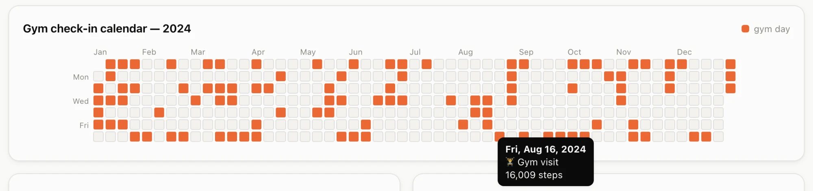

# la-fitness-client (workspace)

Monorepo for [`la-fitness-client`](packages/la-fitness-client), an unofficial, typed
TypeScript client for the LA Fitness mobile API. Built with [Vite+](https://viteplus.dev).

| Path                                                       | What                                                                                        |
| ---------------------------------------------------------- | ------------------------------------------------------------------------------------------- |
| [`packages/la-fitness-client`](packages/la-fitness-client) | The published library (source, unit tests with mocked HTTP). Usage docs live in its README. |
| [`apps/e2e`](apps/e2e)                                     | Private test project that consumes the **built** package like a real user would.            |

## Why this exists

LA Fitness doesn't give members a usable way to get their own check-in history out:

- **The website only shows the last 12 months**, so older visits are effectively gone.
- **It's HTML, not data.** History is rendered on ASP.NET WebForms (`.aspx`) pages. There's
  no JSON API, so getting the data means scraping markup and juggling form/session state.
- **The mobile app has the data but no export.** You can browse it on your phone, not
  analyse it.

The Android app ([`com.lafitness.lafitness`](https://play.google.com/store/apps/details?id=com.lafitness.lafitness&hl=en_CA))
talks to a JSON API, though. Decompiling the APK with
[Androguard](https://github.com/androguard/androguard) revealed its endpoints, request
envelope, and auth flow. That's what this library is built on. It returns years of
history in one request (tested back to 2022), not just the last 12 months.

It also hides the API's sharp edges, which are easy to get wrong:

- **Device registration.** A new device id is rejected (`401`, `reason: device`) until
  it's registered; the client does this on first login.
- **Two kinds of auth at once.** Data calls need the login token _and_ HTTP Basic
  auth. Without Basic auth the server doesn't reject the call — it just hangs.
- **Odd formats.** Requests use `M/D/YY` dates; responses use 12-hour, zone-less
  timestamps (`09/03/2026 10:20:22 AM`), returned in no particular order, wrapped in a
  `{ Success, Message, Value }` envelope.

You get typed, validated results instead: `Temporal` dates, sorted check-ins, and an
`ApiError` naming the field if the API ever changes shape.

### What you can build with it

Pass your own username and password, and your check-in history becomes plain data you
can chart. For example, a year-at-a-glance calendar:



```ts
import { LAFitnessClient } from "la-fitness-client";

const laf = new LAFitnessClient({
  credentials: {
      username: ********,
      password: *********
    }
});

const checkins = await laf.getCheckinHistory({ startDate: "2024-01-01", endDate: "2024-12-31" });

// One entry per gym day — feed this to any calendar-heatmap component.
```

> Unofficial and not affiliated with LA Fitness. Use it with **your own** account; the
> API can change or be blocked at any time.

## Development

Requires the global [`vp`](https://viteplus.dev/guide/) CLI. It installs the pinned Node 26 and pnpm from `devEngines` in `package.json`.

```bash
vp install                        # install dependencies
vp check                          # format + lint + type-check (whole workspace)
vp run -r test                    # unit tests, then e2e tests (builds the library first)
vp run -r build                   # pack the library to packages/la-fitness-client/dist
vp run ready                      # all of the above, in order
```

Working on one package:

```bash
vp -C packages/la-fitness-client test watch    # unit tests in watch mode
vp -C packages/la-fitness-client pack --watch  # rebuild dist on change
```

### Test layers

- **Unit** (`packages/la-fitness-client/tests`) — imports `src/` directly, mocks `fetch`.
- **Package smoke** (`apps/e2e/tests/package.test.ts`) — imports `la-fitness-client` by
  name, so it resolves through the `exports` map to `dist/`. Catches packaging/bundling
  mistakes the unit tests can't.
- **Live** (`apps/e2e/tests/live.test.ts`) — read-only calls against the real API with
  your own account. Skipped unless credentials are set:

  ```bash
  cp apps/e2e/.env.example apps/e2e/.env   # then fill in LAF_USERNAME / LAF_PASSWORD
  vp run la-fitness-client-e2e#test
  ```

## Contributing

Contributions are welcome, and preferred over maintaining a separate fork. If the API
changes, you need another endpoint, or you hit a bug, please
[open an issue](https://github.com/prabh-62/la-fitness-client/issues) or send a pull
request here, so every fix lands in one place for everyone.

- For larger changes (new endpoints, API changes), open an issue first to agree on the
  approach.
- Run `vp run ready` before opening a PR; CI runs the same checks.
- **Never include credentials or personal data** (passwords, tokens, raw API responses,
  check-in logs, profile details) in issues, PRs, or test fixtures. Use made-up values,
  as the unit tests do.

## How this was built

This codebase was generated with [Claude Code](https://claude.com/claude-code) using
Claude Opus 5.5: the library, tests, Vite+ workspace setup, and CI workflow.
